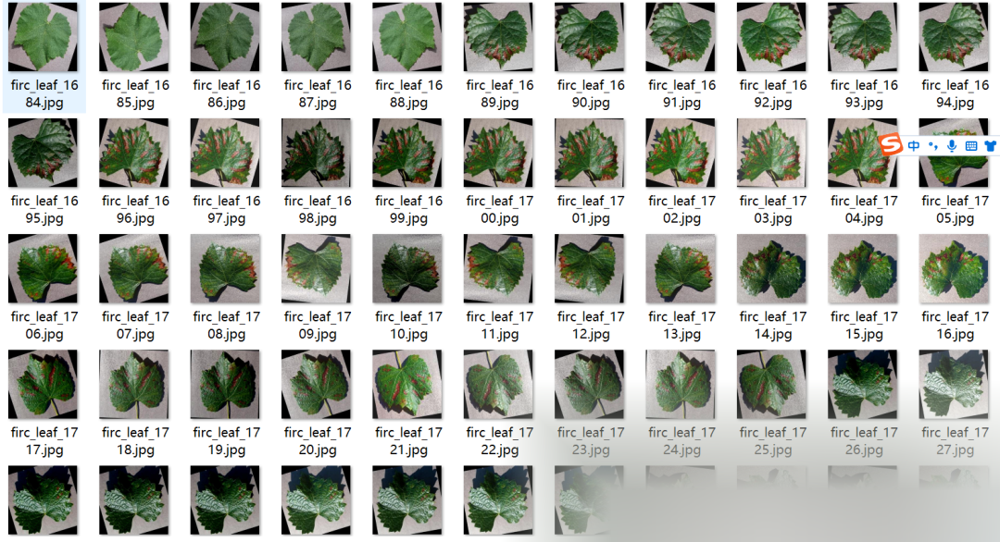
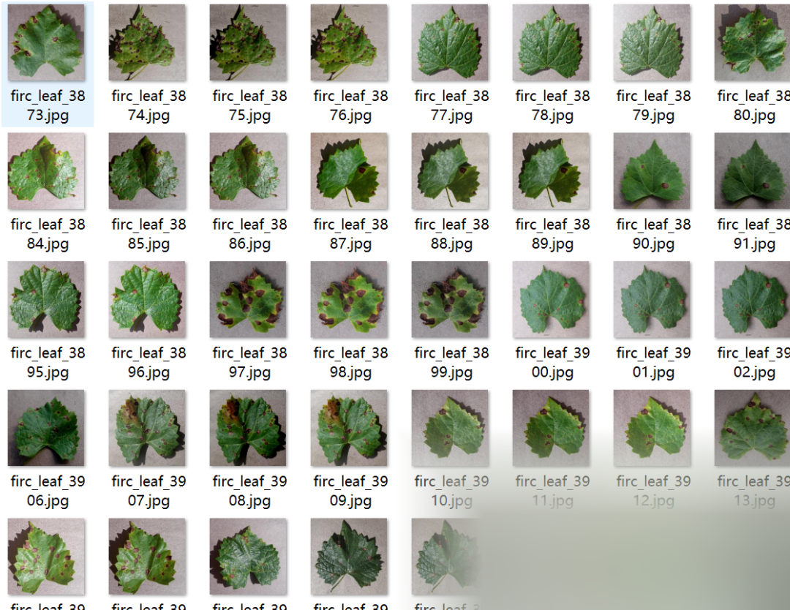
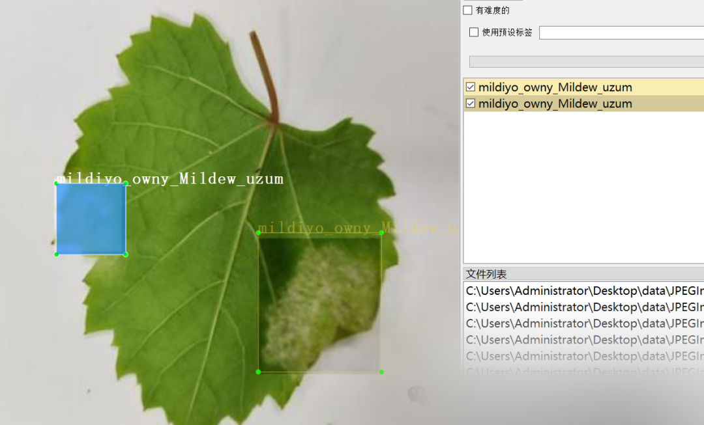
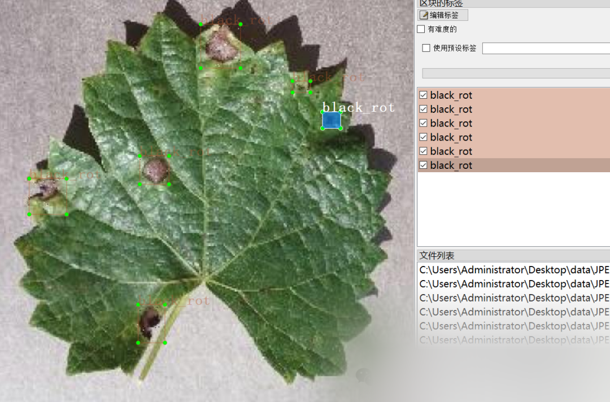

# [Dataset] Object Detection - Grape Leaf Disease Detection Dataset VOC+YOLO format, 5015 images in 4 categories

Important Notice: Grape leaves are single leaflets, and some images have been enhanced. Please carefully review the sample images below to confirm they meet the requirements before downloading.
Dataset Format: Pascal VOC format + YOLO format (txt file without segmentation paths, only containing jpg images along with corresponding VOC format xml files and yolo format txt files)
Number of Images (Total jpg files): 5015
Number of Annotations (Total xml files): 5015
Number of Annotations (Total txt files): 5015
Number of Annotation Categories: 4

["anthracnose", "black_rot", "healthy", "mildiyo_owny_Mildew_uzum"]
Number of boxes per category:
- anthracnose: 15225
- black_rot: 15224
- healthy: 1359
- mildiyo_owny_Mildew_uzum: 2583
Total number of boxes: 34391
Labeling tool used: labelImg
Labeling rules: Draw a box around the category.
Special notice: This dataset does not guarantee the accuracy or precision of the trained models or weight files, and only provides accurate and reasonable annotations.

Image Preview:

Annotation example:

## Payment

Here is a pay link on Stripe ( https://buy.stripe.com/3cs8yP7sY87d0vu9AB ). Please contact me lonlonago@foxmail.com after funding $89, and I will send you a complete data files , thank you!

